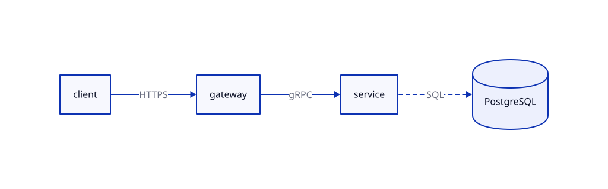
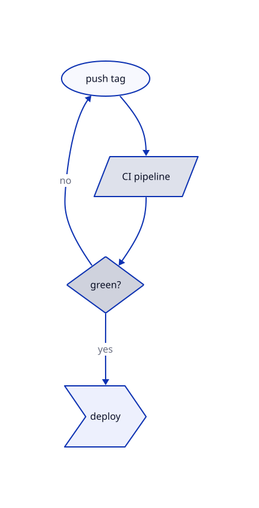

# Demo: D2 in Markdown

This document shows the convention: keep the `d2` source fenced for humans and
agents, render images for viewers.

## Request flow

```d2 name=request-flow
direction: right
client -> gateway: HTTPS
gateway -> service: gRPC
service -> db: SQL {
  style.stroke-dash: 3
}
db: PostgreSQL {shape: cylinder}
```



## Deploy decision

```d2
start: push tag {shape: oval}
ci: CI pipeline {shape: parallelogram}
ok: green? {shape: diamond}
ship: deploy {shape: step}

start -> ci -> ok
ok -> ship: yes
ok -> start: no
```


